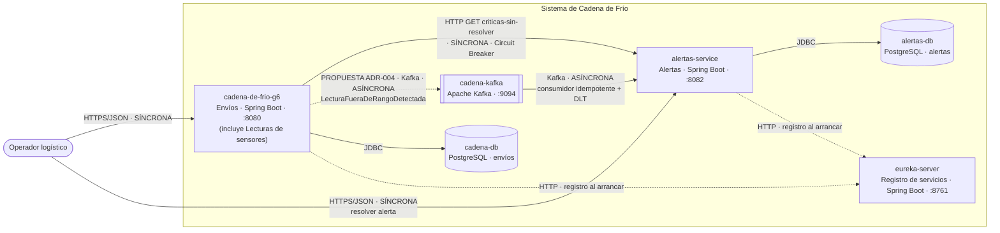

# Arquitectura del Sistema de Cadena de Frío (G6)

## 1. Contexto y motivadores

El sistema vigila envíos de productos refrigerados (alimentos, medicamentos). Cada envío se
registra con una condición requerida (rango de temperatura y humedad); los sensores IoT del
contenedor envían lecturas continuas, y cuando una lectura sale del rango el sistema genera una
alerta para el operador y el cliente. Un envío no se puede cerrar mientras tenga alertas críticas
sin resolver. Lo usan el operador logístico, el cliente dueño de la carga y el conductor.

Atributos de calidad prioritarios, en orden (el orden es la decisión):

| # | Atributo | Escenario medible |
|---|---|---|
| 1 | **Integridad / consistencia** | Si un envío tiene al menos una alerta crítica sin resolver, el 100 % de los intentos de cierre se rechazan, incluso si el servicio de alertas está caído (en ese caso se responde 503, nunca se cierra "a ciegas"). |
| 2 | **Oportunidad de la alerta** (rendimiento) | Una lectura fuera de rango genera su alerta en menos de 5 minutos (criterio de aceptación de HU-03); en condiciones normales, en menos de 2 segundos desde que el evento llega a Kafka. |
| 3 | **Disponibilidad de la detección** | Si el servicio de alertas se cae 10 minutos, ninguna lectura fuera de rango se pierde: los eventos esperan en Kafka y se procesan al volver. |
| 4 | **Modificabilidad** | Cambiar la regla de escalamiento (hoy: 3 lecturas seguidas → crítica) toca una sola clase de dominio (`EscalamientoAlertaService`) y no requiere desplegar Envíos. |
| 5 | **Testabilidad** | Las reglas de dominio se prueban sin Spring ni base de datos (Fakes hechos a mano); cada servicio tiene pruebas que corren con `mvnw test`. |

Restricciones reales:

- Equipo de 3 personas, una por subdominio, con un semestre de plazo.
- Tecnologías que dominamos del curso: Java 25, Spring Boot 4, PostgreSQL, Flyway, Kafka, Docker.
- Infraestructura: solo nuestros portátiles con Docker Desktop; no hay Kubernetes ni nube.
- Los sensores reales no existen todavía: las lecturas se simulan.

## 2. Estilos y patrones por componente

| Componente | Estilo / patrón | Almacén de datos | Comunicación | Atributo que sirve |
|---|---|---|---|---|
| `cadena-de-frio-g6` (Envíos) | Hexagonal + DDD (agregado `Envio`, value objects `RangoTemperatura`, `RangoHumedad`) | PostgreSQL `cadena-db` (Flyway) | Llama a Alertas por HTTP síncrono con Circuit Breaker | Integridad (regla de cierre) y testabilidad del dominio |
| `alertas-service` (Alertas) | Microservicio + hexagonal + DDD (agregado `Alerta`, value object `SeveridadAlerta`) | PostgreSQL propio `alertas-db` (Database per Service) | Sirve HTTP; consume Kafka | Modificabilidad de la regla de escalamiento; disponibilidad independiente de Envíos |
| Lecturas de sensores (`cadena-de-frio-g6/.../sensores`) | Hexagonal; detecta lecturas fuera de rango dentro del monolito | — (en el diseño objetivo, base de series de tiempo) | Hoy no se comunica con otros servicios. **Propuesta (ADR-004):** publicar `LecturaFueraDeRangoDetectada` en Kafka | Oportunidad de la alerta y escalabilidad del volumen de lecturas |
| `eureka-server` | Service Registry (descubrimiento de servicios) | — | Cada servicio se registra con su nombre al arrancar | Modificabilidad del despliegue: nadie depende de una dirección escrita a mano |
| `cadena-kafka` | EDA (publicar / suscribir) | Log de eventos | Tópico `sensores.lecturas-fuera-de-rango` + su `.DLT`; hoy los eventos se publican a mano para pruebas | Desacoplamiento y durabilidad: ninguna lectura fuera de rango se pierde |
| Consumidor de lecturas en Alertas | Idempotent Consumer + Dead Letter Topic + reintentos con backoff | Tabla `eventos_procesados` | Kafka | Integridad (un evento repetido no duplica alertas) y disponibilidad (un mensaje roto no detiene el consumidor) |
| Consulta "¿alertas críticas sin resolver?" | Circuit Breaker + *fail-closed* | — | HTTP `GET /api/alertas/envios/{id}/criticas-sin-resolver` | Integridad (nunca se cierra sin saber) y disponibilidad (falla rápido si Alertas cae) |

**Prueba de necesidad.** Cada fila responde a un problema concreto: Kafka existe porque el volumen
de lecturas y la regla de "no perder ninguna" no se sostienen con llamadas HTTP una por una; Eureka
existe para que los servicios se encuentren por nombre y no por un puerto fijo; el
consumidor idempotente existe porque Kafka entrega "al menos una vez"; el Circuit Breaker existe
porque el cierre de un envío depende de otro proceso que puede estar caído. Descartamos estilos que
no resolvían nada hoy: no hay API Gateway (un solo cliente y dos servicios de negocio) ni CQRS (las
consultas de historial todavía no existen). Deuda reconocida: Envíos todavía llama a Alertas con
la URL fija `alertas-service.url`; el siguiente paso es resolverla por nombre a través de Eureka.

**Antipatrones revisados.** El C4 inicial (agosto) dibujaba al servicio de alertas leyendo
directamente la base de datos de Envíos por JDBC: eso es una base de datos compartida, que acopla
los despliegues y los esquemas. Lo corregimos: Alertas no lee la base de Envíos; Envíos pregunta a
Alertas por su API (ADR-003). Tampoco hay cadenas síncronas largas: el único salto síncrono es
Envíos → Alertas.

## 3. Diagrama de contenedores (C4)

Solo aparecen los contenedores que existen hoy como carpeta o contenedor Docker del repositorio.
Las flechas continuas están implementadas; la flecha punteada de Envíos a Kafka es una **propuesta**
(ADR-004), todavía no está en el código.

Conexiones:

| Desde | Hacia | Tipo | Por qué |
|---|---|---|---|
| Envíos | Alertas | **Síncrona** (HTTP) | Para cerrar un envío se necesita la respuesta ya: consultar es síncrono. |
| Kafka (tópico de sensores) | Alertas | **Asíncrona** (Kafka) — implementada del lado de Alertas; el productor en sensores es **Propuesta** (ADR-004) | Propagar un hecho ("una lectura salió del rango") se puede procesar un instante después; no hace falta que Alertas responda en ese momento. |

Eventos publicados:

| Evento (en pasado) | Productor | Consumidores | Datos |
|---|---|---|---|
| `LecturaFueraDeRangoDetectada` | Lecturas de sensores (**Propuesta**, ADR-004; hoy se simula con `kafka-console-producer`) | `alertas-service` (implementado) | `envioId`, `sensorId`, `temperatura`, `humedad`, `fechaHora`, `lecturasFueraDeRangoConsecutivas` (clave del mensaje: `envioId`) |

Capa anticorrupción: el adaptador `ConsultaAlertasCriticasHttp` de Envíos traduce entre su
`EnvioId` (texto) y el UUID que usa Alertas; si el id no es un UUID, falla antes de llamar.

## 4. Decisiones (ADR)

### ADR-001: Extraer Alertas como servicio con su propia base de datos

- Estado: Aceptada
- Fecha: 2026-11-10

**Contexto.** Alertas vivía como paquete dentro de `cadena-de-frio-g6` y Envíos leía sus alertas
en memoria. Alertas tiene el mayor ritmo de cambio (la regla de escalamiento y la de severidad se
ajustan con frecuencia) y debe seguir recibiendo lecturas aunque Envíos se despliegue o se caiga.
El C4 inicial además proponía que Alertas leyera la base de Envíos directamente.

**Decisión.** Alertas es un servicio independiente (`alertas-service`, puerto 8082) con su propia
base PostgreSQL (`alertas-db`) y sus migraciones Flyway. Ningún otro servicio accede a esa base:
se habla con Alertas por HTTP o por eventos.

**Alternativas descartadas.**
- *Monolito modular* (dejar Alertas como módulo de `cadena-de-frio-g6`): más simple de operar, pero
  un cambio en la regla de escalamiento obligaría a desplegar Envíos, y una caída de Envíos
  detendría la detección de alertas.
- *Base de datos compartida* (lo del C4 inicial): evita una llamada HTTP, pero acopla los esquemas;
  cualquier cambio en la tabla de envíos rompería a Alertas sin que nadie lo note.

**Consecuencias.**
- (+) Alertas se despliega y escala por separado; su esquema solo lo cambia su equipo.
- (+) La regla de escalamiento se modifica sin tocar Envíos (atributo 4).
- (−) Hay un proceso y una base más que levantar: para probar el cierre de un envío hay que tener
  corriendo los dos servicios.
- (−) La consulta de alertas críticas ahora cruza la red y puede fallar (ver ADR-003).

### ADR-002: Recibir las lecturas fuera de rango por Kafka con consumidor idempotente y DLT

- Estado: Aceptada
- Fecha: 2026-11-10

**Contexto.** Los sensores producen el mayor volumen del sistema y ninguna lectura fuera de rango
puede perderse (atributo 3). Kafka entrega cada mensaje "al menos una vez": tras un reinicio o una
reasignación de particiones un evento puede llegar dos veces, y un mensaje mal formado puede
bloquear la partición si se reintenta sin fin.

**Decisión.** Alertas consume `LecturaFueraDeRangoDetectada` del tópico
`sensores.lecturas-fuera-de-rango` (implementado; que Lecturas de sensores lo publique es la
propuesta ADR-004, y mientras tanto los eventos se publican a mano para probar). Alertas lo consume registrando cada evento (tópico-partición-offset)
en la tabla `eventos_procesados` **en la misma transacción** que la alerta: si el evento ya está, se
ignora. Los mensajes imposibles de procesar (JSON roto, UUID inválido) van directo a
`sensores.lecturas-fuera-de-rango.DLT`; los errores transitorios se reintentan 3 veces con espera
de 1, 2 y 4 segundos.

**Alternativas descartadas.**
- *HTTP síncrono de sensores a alertas*: si Alertas está caído, la lectura se pierde o sensores debe
  guardarla y reintentar por su cuenta; además acopla el ritmo de sensores al de Alertas.
- *Reintentar sin DLT* (comportamiento por defecto): un mensaje venenoso se reintenta 10 veces sin
  pausa y luego se descarta sin dejar rastro.
- *Idempotencia con dos escrituras separadas* (registrar el evento y luego crear la alerta, como en
  el taller de EDA): si el proceso cae entre ambas, se pierde la alerta.

**Consecuencias.**
- (+) Una caída de Alertas no pierde lecturas: los eventos esperan en Kafka (probado reiniciando el
  servicio y reentregando todos los eventos: el número de alertas no cambió).
- (+) Un mensaje roto queda guardado y diagnosticable en la DLT, con la excepción en sus cabeceras.
- (−) Hay que operar Kafka y vigilar la DLT; hoy nadie la monitorea (riesgo R3).
- (−) La alerta aparece con un pequeño retraso respecto a la lectura (consistencia eventual).
- (−) El contrato del evento ahora es compartido: si sensores cambia un campo, Alertas debe enterarse.

### ADR-003: Consultar a Alertas de forma síncrona, con Circuit Breaker y *fail-closed*

- Estado: Aceptada
- Fecha: 2026-11-10

**Contexto.** `CierreEnvioService` no puede cerrar un envío con alertas críticas sin resolver
(atributo 1). Desde ADR-001 esa información vive en otro proceso. Si Alertas está caído o lento,
el cierre no debe quedarse colgado ni, mucho menos, cerrar el envío sin verificar.

**Decisión.** Envíos implementa su puerto `ConsultaAlertasCriticas` con un adaptador HTTP
(`ConsultaAlertasCriticasHttp`) que llama a `GET /api/alertas/envios/{id}/criticas-sin-resolver`,
con plazos de 2 s (conexión) y 3 s (lectura) y un Circuit Breaker de Resilience4j (ventana de 10
llamadas, se abre con 50 % de fallos, 10 s abierto). Si no puede obtener respuesta, responde **503**
y el envío no se cierra (*fail-closed*).

**Alternativas descartadas.**
- *Réplica local de alertas en Envíos alimentada por eventos* (estilo CQRS): el cierre no
  dependería de que Alertas esté arriba, pero la réplica puede estar desactualizada justo en el
  momento del cierre, y eso viola el atributo 1.
- *gRPC*: más eficiente, pero exige mantener el `.proto` en los dos servicios para una sola consulta
  de baja frecuencia; HTTP/JSON basta.
- *Fail-open* (si Alertas no responde, permitir el cierre): mejor disponibilidad del cierre, pero un
  envío con la cadena de frío rota podría cerrarse como conforme.

**Consecuencias.**
- (+) Nunca se cierra un envío sin saber si tiene alertas críticas.
- (+) Si Alertas cae, Envíos falla rápido (en milisegundos con el circuito abierto) en vez de
  acumular peticiones colgadas.
- (−) Con Alertas caído no se puede cerrar ningún envío: priorizamos integridad sobre
  disponibilidad del cierre (compromiso consciente).
- (−) El puerto de Envíos no cambió, pero ahora hay una dependencia de red que hay que configurar
  (`alertas-service.url`).

### ADR-004: Extraer Lecturas de sensores y publicar sus eventos con Transactional Outbox

- Estado: **Propuesta** (no implementada)
- Fecha: 2026-11-11

**Contexto.** La detección de lecturas fuera de rango (`DeteccionFueraDeRangoService`) vive hoy
dentro de `cadena-de-frio-g6` y no publica nada: Alertas ya sabe consumir el evento (ADR-002),
pero nadie lo produce. Además, el evento actual no trae cuántas lecturas seguidas van fuera de
rango, y sin ese dato ninguna alerta escala a crítica.

**Decisión propuesta.** Extraer `sensores-service` como servicio propio y publicar
`LecturaFueraDeRangoDetectada` (con el campo `lecturasFueraDeRangoConsecutivas`) mediante un
Transactional Outbox: el evento se guarda en una tabla en la misma transacción que la lectura y un
proceso aparte lo envía a Kafka.

**Alternativas descartadas.**
- *Publicar directamente con `KafkaTemplate` desde el servicio de detección*: más simple, pero si
  Kafka está caído en ese momento el evento se pierde (escritura dual).
- *Que sensores llame a Alertas por HTTP*: acopla la disponibilidad de la ingesta, el contexto de
  mayor volumen, a la de Alertas.

**Consecuencias.**
- (+) Cerraría el flujo de punta a punta sin perder eventos aunque Kafka caiga.
- (−) Un servicio, una tabla outbox y un proceso de sondeo más que operar.
- (−) Mientras no se implemente, el flujo real de alertas por lecturas solo se puede probar
  publicando eventos a mano (riesgo R1).

## 5. Fitness functions

| # | Regla | Cómo se verifica | Cuándo |
|---|---|---|---|
| 1 | Las pruebas de cada servicio pasan (`mvnw test`), incluidas las del dominio sin Spring. | Flujo de CI con matriz por servicio (`.github/workflows`), igual que en los talleres. | En cada push y en cada Pull Request. |
| 2 | Ningún servicio usa el código ni la base de otro: `alertas-service` no importa paquetes de `cadena_de_frio_g6` y viceversa. | `grep -r "cadena_de_frio_g6" alertas-service/src` y `grep -r "alertas_service" cadena-de-frio-g6/src` deben devolver vacío (paso del CI). | En cada push (CI). |
| 3 | El esquema de cada base lo controla Flyway: Hibernate solo valida. | `spring.jpa.hibernate.ddl-auto=validate` en los dos servicios; la prueba de arranque (`contextLoads`) falla si una entidad no coincide con su migración. | En cada `mvnw test`. |
| 4 | Un evento repetido no genera alertas duplicadas. | Prueba `ProcesadorLecturasFueraDeRangoTest.unEventoYaProcesadoNoGeneraOtraAlerta`. | En cada `mvnw test`. |

## 6. Mesh: ¿lo necesitamos?

**Service mesh: no.** Tenemos 2 servicios de negocio más el registro Eureka (un tercero cuando
Lecturas de sensores se extraiga), un solo
equipo de 3 personas y ningún clúster de Kubernetes, que es donde un mesh (Istio, Linkerd) se
instala. La única llamada entre servicios ya tiene su resiliencia en el código (Circuit Breaker y
plazos en `ConsultaAlertasCriticasHttp`); con decenas de servicios y requisitos uniformes de mTLS y
reintentos sí valdría la pena sacarlo del código a la infraestructura.

**Data mesh: no.** Hay 3 dominios de datos (envíos, lecturas, alertas) y un solo equipo que los
conoce todos; no hay áreas de negocio separadas que publiquen datos como producto. En su lugar,
cada servicio es dueño de su base (Database per Service) y comparte hechos por eventos.

## 7. Riesgos y deuda conocida

| # | Riesgo / deuda | Qué haríamos si se materializa |
|---|---|---|
| R1 | Lecturas de sensores sigue dentro de `cadena-de-frio-g6` (rama `Lectura-Sensores`) y todavía no publica en Kafka: hoy los eventos se simulan con `kafka-console-producer`. | Extraer `sensores-service` y publicar el evento con un Outbox, para no perder lecturas si Kafka cae. |
| R2 | El evento de sensores aún no trae `lecturasFueraDeRangoConsecutivas`: Alertas cuenta 1 y la alerta nunca escala a crítica. | Agregar el campo en el productor; el consumidor ya lo usa si viene (lector tolerante). |
| R3 | Nadie vigila la DLT: un mensaje que llegue ahí queda guardado pero sin aviso. | Métrica de mensajes en la DLT y alerta cuando sea mayor que cero. |
| R4 | Con Alertas caído no se puede cerrar ningún envío (ADR-003, *fail-closed*). | Exponer el estado del circuito en `/actuator/health` y documentar el procedimiento de recuperación. |
| R5 | Un solo broker de Kafka, sin réplicas: si cae, se detiene la llegada de alertas (aunque no se pierden los eventos ya escritos). | Aceptado para el curso; en producción, 3 brokers con factor de replicación 3. |
